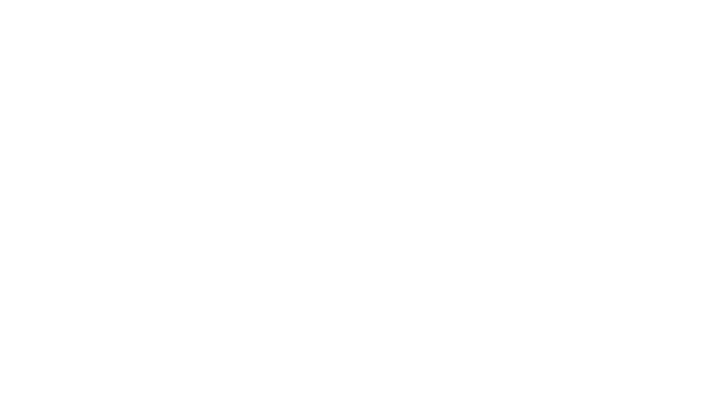

<p align="center">
  
</p>

<h1 align="center">AgenticOps – AI Network Configuration Agent </h1>

<p align="center">
  
  
  
  
  
  
  
  
</p>


## Features

- **Automatic topology discovery** — reads any GNS3 topology via REST API (localhost:3080)
- **Device classification** — identifies routers (Dynamips/IOU/QEMU), switches, VMs, Docker containers, VPCS, NAT nodes
- **Zero-touch SSH setup** — configures SSH from scratch via GNS3 Telnet console
- **IP assignment** — auto-assigns IPs on interfaces and sub-interfaces
- **Routing protocols** — OSPF, EIGRP, RIPv2, static routes
- **Access Control Lists** — create/remove ACLs blocking any traffic type (ICMP, TCP, UDP, specific ports)
- **VLAN management** — router-on-a-stick with dot1Q sub-interfaces
- **Docker container Configuration** — configures IP and gateway on alpine:latest container with docker_exec_command
- **Browser Classification** — recognise any Browser from GNS3 Market as endpoint_vm (ATM only Firefox)
- **Configuration backup** — saves running-config to local files
- **Troubleshooting** — checking the connectivity of the network
- **Documentation** — generate documentation in .md format of the whole network
- **Multi-provider LLM fallback** — NVIDIA NIM, Mistral, OpenRouter or any OpenAI-compatible API, with automatic failover on rate limits and outages
- **Human approval** — every configuration change is shown in full and runs only after you confirm it (`y` / `n` / `a` = all for the current request); read-only tools run without asking
- **Secret redaction** — passwords, keys and hashes are masked before anything is sent to the LLM
- **Containerized** - the agent is installed in a Docker Container, good for portability
- **Portable** — works with any GNS3 topology, no hardcoded IPs or device names


## Structure

```
agenticOps/              
├── Dockerfile           
├── .dockerignore        
├── .gitignore
├── README.md
├── requirements.txt
├── run.sh
├── .env.example
├── agenticops/
│   ├── agent.py
│   ├── llm_provider.py
│   ├── tools.py
│   ├── gns3_client.py
│   └── net_config.py
├── logs/
├── docs/
└── backups/     
```

## Requirements

- Linux with GNS3 2.2+ and its local server on `localhost:3080`
- **Docker Engine** (`docker-ce`), not Docker Desktop: GNS3 attaches Docker nodes to the topology
  through `ubridge` on the host, which does not work with containers running inside the Docker
  Desktop VM
- Python 3.12 (only for running without Docker)
- At least one API key from an OpenAI-compatible LLM provider

## Install with Docker

Build the image:

```bash
docker build -t agenticops .
```

Configure the LLM providers: copy the template and fill in at least one `*_API_KEY`
(see [LLM providers & fallback](#llm-providers--fallback)):

```bash
cp .env.example .env
```

`.env` is git-ignored, so your keys never end up in the repository.

Run the container (`run.sh` passes `.env` with `--env-file`; exported shell variables override it):

```bash
chmod +x run.sh
./run.sh
```

The legacy setup still works without a `.env` file:

```bash
export OPENROUTER_API_KEY="sk-or-v1-your-key-here"
./run.sh
```

## Run the Container manually:

```bash
docker run -it --rm --network host \
  --name agenticops \
  --env-file .env \
  agenticops
```

## Run locally (without Docker)

```bash
python3 -m venv .venv
.venv/bin/pip install -r requirements.txt
.venv/bin/python agenticops/agent.py   # reads .env automatically
```

## LLM providers & fallback

Free tiers have tight limits (OpenRouter `:free` models allow ~50 requests/day), and one agentic
session can use many requests. AgenticOps therefore talks to an ordered list of OpenAI-compatible
providers and switches automatically.

**Where to get keys**

| Provider | Key | Default base URL |
|---|---|---|
| `nvidia` | <https://build.nvidia.com> | `https://integrate.api.nvidia.com/v1` |
| `mistral` | <https://console.mistral.ai> | `https://api.mistral.ai/v1` |
| `openrouter` | <https://openrouter.ai/keys> | `https://openrouter.ai/api/v1` |

**Configuration** (`.env`, created from `.env.example`):

```bash
LLM_PROVIDERS=nvidia,mistral,openrouter   # order = priority
NVIDIA_API_KEY=...
NVIDIA_MODEL=nvidia/nemotron-3-ultra-550b-a55b
MISTRAL_API_KEY=...
MISTRAL_MODEL=mistral-medium-latest
OPENROUTER_API_KEY=...
OPENROUTER_MODEL=nvidia/nemotron-3-ultra-550b-a55b:free
```

Pick models that support **tool calling**; a model without it answers with HTTP 400.
A provider without an API key is skipped with a warning. With only `OPENROUTER_API_KEY`
set, the agent behaves exactly as before.

**How fallback works**

- Each request goes to the first provider that is not cooling down; the CLI shows which one
  answered, e.g. `[mistral/mistral-medium-latest]`. Type `model` to see the status of all providers.
- `429`, `402`, `500`, `502`, `503`, `504`, timeouts and connection errors put the provider in
  cooldown and the next one is tried. `retry-after` (and OpenRouter's `X-RateLimit-Reset`) is honoured;
  otherwise the cooldown is `LLM_COOLDOWN_SECONDS` (60 s), or `LLM_NETWORK_COOLDOWN_SECONDS` (30 s)
  for network errors.
- `400`, `401`, `403`, `404` do **not** fall back: they mean a bad request, a wrong key or a
  wrong model name, and the error says which variable to check.
- If every provider is unavailable the session stops with a summary of each error and the time
  the next provider becomes available.
- Responses are normalized (tool call ids, malformed JSON arguments, provider-specific fields such
  as `reasoning_content`), so one conversation can move between providers.

**Adding another OpenAI-compatible provider** — pick a name, add it to `LLM_PROVIDERS`, and set
the three variables (the name is upper-cased, `-` becomes `_`):

```bash
LLM_PROVIDERS=groq,mistral,openrouter
GROQ_API_KEY=...
GROQ_BASE_URL=https://api.groq.com/openai/v1
GROQ_MODEL=...
```

**Secret redaction** — some free tiers may use prompts for training, and device output contains
secrets. With `LLM_REDACT_SECRETS=true` (default), everything sent to the LLM is masked as
`<REDACTED>`: `enable secret/password`, `username ... secret/password`, line `password`,
`snmp-server community`, `key-string`, `tacacs/radius ... key`, `crypto isakmp key`,
type 5/8/9 hashes, and the password/secret values stored in `credentials.json`.
Only the copy sent to the LLM is masked: configuration pushed to devices and the local history are
unchanged. Messages you type yourself are not masked, so you can still give the agent a password
(e.g. for `update_credentials`).

Other variables: `LLM_TIMEOUT` (60), `LLM_MAX_TOKENS` (4096), `LOG_LEVEL` (`WARNING`).
API keys and unmasked content are never logged.

## After you configure SSH on R1
Add a route on your Ubuntu machine so you can reach the internal GNS3 network through R1:
```bash
sudo ip route add 10.0.0.0/8 via <R1_DHCP_IP>
```
Replace `<R1_DHCP_IP>` with the IP that R1 received via DHCP on the NAT interface (FastEthernet2/0). Check it with `show ip interface brief` on R1's console.

## In case of 503 errors on the main model
Add a second provider to `LLM_PROVIDERS` (see above) so the agent fails over automatically,
or switch the OpenRouter model:
```bash
export OPENROUTER_MODEL="google/gemma-4-31b-it:free"
```

## Related projects

- [AgenticOps AAA Server](https://github.com/hehealexandru/agenticops-aaa-server) — FreeRADIUS
  server image for GNS3 labs, with separate profiles for the network administrator and the
  agent. RADIUS configuration from AgenticOps is in progress; TACACS+ will follow.
